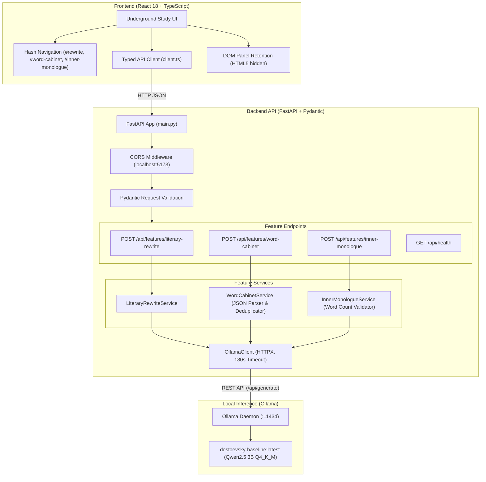

# Dostoevsky AI

> *Where Language Meets the Human Psyche.*

**Dostoevsky AI** is a local-first literary writing and vocabulary assistant inspired by the psychological and philosophical themes of Fyodor Dostoevsky. The application serves a locally hosted language model to help writers explore the contradictions of human consciousness, moral ambivalence, pride, alienation, and introspective character monologues.

Built with **FastAPI**, **React 18**, **TypeScript**, and **Ollama**, the project emphasizes privacy, reproducible local inference, defensive structured JSON validation, and rigorous empirical evaluation.

---

## 1. Project Overview & Core Studios

The application provides three specialized creative studios within a cohesive dark academia interface ("The Underground Study"):

1. **Studio 01: Literary Rewrite (`#rewrite`)**  
   Transforms ordinary, flat prose into psychologically layered, introspective writing. The model emphasizes hesitation, subtext, and emotional tension while strictly preserving factual narrative details and relationships.
2. **Studio 02: Word Cabinet (`#word-cabinet`)**  
   Explores precise vocabulary for nuanced or conflicting emotional states. Generates structured entries complete with grammatical part of speech, plain-language definitions, emotional connotation, intensity ratings (1–5), subtle distinctions from nearest synonyms, and natural usage examples.
3. **Studio 03: Inner Monologue (`#inner-monologue`)**  
   Composes original interior monologues capturing conflicting motives, moral anxiety, and self-interrogation across first-person ("I") or third-person perspectives, with user-configurable word count ranges.

---

## 2. Interface Demonstration & Screenshot Checklist

The user interface is styled according to **The Underground Study** design specification—utilizing aged parchment tones, dark ink backgrounds (`#161513`), literary serif typography, and restrained warm brass accents (`#c98a2c`).

### Visual Documentation Status
No image files are currently committed to the repository. Evaluators running the application locally will see the live interface across the following views:

- [ ] **Literary Rewrite Studio View:** Split-pane editor showing source passage, rewriting indicator, and side-by-side recast output with copy action.
- [ ] **Word Cabinet Studio View:** Input context, suggestion count selector (3–8 entries), latency helper copy, and interactive vocabulary card grid with intensity badges.
- [ ] **Inner Monologue Studio View:** Situation prompt, point-of-view toggle, target length bounds, and generated introspective stream with word-count verification.
- [ ] **System Health Bar:** Real-time indicator displaying the connection state between backend API and local Ollama daemon.

*(A visual asset gallery will be captured and added prior to tagged public distribution).*

---

## 3. Technology Stack

### Frontend Architecture
- **Framework:** React 18.3.1 with TypeScript ~5.6.3
- **Bundler & Tooling:** Vite 8.3.5
- **Testing:** Vitest 5.0.5, `@testing-library/react` 16.3.3, `@testing-library/user-event` 14.6.8, `jsdom` 29.1.1
- **Styling:** Custom CSS design system (`tokens.css`, `global.css`) with zero third-party component libraries
- **State Architecture:** HTML5 DOM panel retention via `hidden` attributes, preserving drafts across studio navigation without third-party state bloat
- **Routing:** Bidirectional URL hash routing (`#rewrite`, `#word-cabinet`, `#inner-monologue`) with full browser history support

### Backend Architecture
- **Framework:** FastAPI 0.115+ running on Uvicorn 0.32+
- **Data Validation:** Pydantic 2.6+ with strict request bounds, custom field validators, and runtime schema enforcement
- **HTTP Client:** HTTPX 0.27+ with explicit connection and generation timeout separation (3s connect, 180s read)
- **Testing:** Pytest 8.4.2 with AnyIO 4.15 and Starlette TestClient

### Model & Local Inference Pipeline
- **Base Model:** `qwen2.5:3b` (Qwen Team, Alibaba Cloud)
- **Quantization:** `Q4_K_M` (4-bit medium quantization via llama.cpp)
- **Serving Engine:** Local Ollama runtime (`http://localhost:11434`)
- **Serving Model:** `dostoevsky-baseline:latest` configured via root `Modelfile`
- **Model Configuration:** Prompt-configured base model with targeted sampling parameters (`temperature 0.85`, `top_p 0.9`, `repeat_penalty 1.1`, `num_ctx 4096`). **Weights are prompt-engineered, not fine-tuned.**

---

## 4. Architecture Overview



### Verified API Endpoints
- `GET  /api/health` — Checks backend status and probes Ollama availability.
- `POST /api/features/literary-rewrite` — Recasts prose up to 5,000 characters.
- `POST /api/features/word-cabinet` — Generates 3 to 8 structured vocabulary entries from emotional context (up to 2,000 characters). Overrides `num_predict: 1400` for JSON completeness.
- `POST /api/features/inner-monologue` — Generates 50 to 500 word interior monologue with target range validation.

---

## 5. Prerequisites & Environment

Verify your system meets the following prerequisites before setup:
- **Operating System:** Windows, macOS, or Linux (commands below use Windows PowerShell).
- **Python:** Python 3.11 or higher (tested on Python 3.13.5).
- **Node.js:** Node.js 18.x or higher (tested on Node.js 20+).
- **npm:** npm 9.x or higher.
- **Ollama:** Installed and running locally ([ollama.com](https://ollama.com)).
- **Hardware Guidance:** 8 GB RAM minimum; 16 GB recommended for smooth 3B model execution. Disk storage requires ~2.5 GB for Ollama weights.

---

## 6. Installation & Quick Start

Open PowerShell and follow these step-by-step instructions:

### Step 1: Model Setup in Ollama
Ensure the Ollama application or daemon is active:
```powershell
# 1. Pull the base Qwen2.5 3B model
ollama pull qwen2.5:3b

# 2. Build the baseline serving model from the repository root Modelfile
ollama create dostoevsky-baseline -f ./Modelfile

# 3. Confirm model availability
ollama list
```

### Step 2: Backend Setup
In a dedicated PowerShell window:
```powershell
# Navigate to backend directory
cd backend

# Create virtual environment
python -m venv .venv

# Activate virtual environment
.\.venv\Scripts\Activate.ps1

# Install backend dependencies in editable development mode
python -m pip install -e ".[dev]"

# Start the FastAPI server
uvicorn dostoevsky_ai.main:app --host 127.0.0.1 --port 8000 --app-dir src --reload
```
The backend health endpoint is available at `http://127.0.0.1:8000/api/health`.

### Step 3: Frontend Setup
In a second PowerShell window:
```powershell
# Navigate to frontend directory
cd frontend

# Install dependencies
npm install

# Start Vite development server
npm run dev
```
Open your browser to `http://localhost:5173`.

---

## 7. Testing & Verification

The repository maintains full automated test coverage across both frontend and backend suites. All tests execute independently without requiring a running Ollama daemon.

### Run All Backend Tests (Pytest)
```powershell
backend\.venv\Scripts\python.exe -m pytest backend/tests
```
*Current test suite:* **82 passed**, 0 failures across 5 test suites.

### Run All Frontend Tests (Vitest)
```powershell
npm test --prefix frontend
```
*Current test suite:* **55 passed**, 0 failures across 6 test files.

### Typecheck & Production Build
```powershell
# TypeScript compilation check
node frontend/node_modules/typescript/bin/tsc --noEmit -p frontend/tsconfig.app.json

# Production asset build
npm run build --prefix frontend
```
*Verification status:* 0 type errors; production bundle built cleanly in ~400ms (gzip 53.5 kB).

---

## 8. Empirical Evaluation & Scientific Rigor

A central differentiator of Dostoevsky AI is its commitment to **hypothesis falsification and empirical integrity**. Rather than claiming unverified improvements, the repository separates evidence into five distinct tiers:

```
+-----------------------------------------------------------------------------------+
| Tier 1: AI-Assisted Preliminary Evaluations                                       |
| Automated LLM-as-a-judge scoring on 15 synthetic canonical test cases (Phase 4).  |
+-----------------------------------------------------------------------------------+
                                          |
+-----------------------------------------------------------------------------------+
| Tier 2: Algorithmic Prompt Experimentation (EXP-WC-01)                             |
| Evaluated anti-echo directives. Rejected due to severe vocabulary relevance drop. |
+-----------------------------------------------------------------------------------+
                                          |
+-----------------------------------------------------------------------------------+
| Tier 3: Contemporaneous Double-Blind Human Evaluation (EXP-WC-02)                 |
| 20 blinded items, 2 independent raters, 120 ratings, Cohen's kappa (Phase 6E).    |
| RESULT: REJECTED (delta -0.20 on distinction usefulness; rater 2 delta -0.40 on   |
| relevance). Automated cryptographic rollback to verified baseline prompt.         |
+-----------------------------------------------------------------------------------+
                                          |
+-----------------------------------------------------------------------------------+
| Tier 4: Live Integration Testing (Phase 7C)                                       |
| Measured real inference latencies, word counts, and schema validation.            |
+-----------------------------------------------------------------------------------+
                                          |
+-----------------------------------------------------------------------------------+
| Tier 5: Qualitative Literary Appraisal                                            |
| Descriptive appraisal of psychological rhythm, moral tension, and dark irony.     |
+-----------------------------------------------------------------------------------+
```

### The EXP-WC-02 Falsification Case Study
In experiment `EXP-WC-02-DISTINCTION-STRUCTURE`, structured distinction guidance was introduced to eliminate synonym circularity. 
- In a pre-registered double-blind evaluation, two human raters independently scored 20 randomized, blinded outputs using an established 1–5 rubric.
- Inter-rater agreement reached 100% within 1 point and quadratic weighted Cohen's \(\kappa = 0.3781\).
- Both raters observed a **-0.20 delta** in distinction usefulness, noting that forced distinction structures sounded mechanical and degraded overall vocabulary relevance.
- Under pre-registered decision rules (reject if delta \(\le 0.00\)), the experiment was decisively **REJECTED**, and the system prompt was immediately restored to the verified baseline hash (`be472f536fbb27ed460f03e744889c95af91db3a8f8ac8809992ac55dd447686`).

---

## 9. Privacy, Security & Disclosed Limitations

### Privacy & Data Handling
- **Local-First Privacy:** All prompt processing occurs in local RAM on your machine.
- **Zero Logging:** User input, drafts, and generated responses are never logged to console, disk, or external servers.
- **No Telemetry:** Zero external tracking, analytics, or third-party API keys required.

### Disclosed Operational Limitations
- **Local Hardware Latency:** On local CPUs, generation times vary. Literary Rewrite averages ~18s; 6 structured Word Cabinet entries take ~76s. Users can select 4 words to reduce latency.
- **3B Model Length Variance:** Smaller 3B models tend to under-generate on long targets (e.g. generating 147 words when 180 words are requested). The system transparently flags length mismatches in `validation_warnings` rather than silently masking them.
- **Vocabulary Connotation:** Vocabulary suggestions and distinctions are creative stylistic aids, not authoritative lexicographical or clinical psychological definitions.
- **Controlled Local Scope:** The application is architected for single-user desktop exploration. It does not provide multi-tenant authentication, user management, or distributed queueing.

---

## 10. Future Roadmap

Planned enhancements for future iterations:
- [ ] **Streaming Responses (SSE):** Token streaming for Literary Rewrite and Inner Monologue to eliminate perceived waiting time.
- [ ] **Fine-Tuning Investigation (LoRA):** Exploration of low-rank parameter-efficient adapters trained on public domain 19th-century psychological prose.
- [ ] **GPU Layer Offloading:** Automated detection of dedicated GPU acceleration (`num_gpu`) in Ollama Modelfile.
- [ ] **Export Capabilities:** Markdown and text export for generated drafts and vocabulary collections.

---

## 11. Attribution & License

- **Attribution:** Inspired by the literary works, themes, and psychological explorations of Fyodor Dostoevsky.
- **Corpus Texts:** Public-domain source texts referenced in development are sourced from Project Gutenberg and kept locally excluded from Git.
- **License Status:** No open-source license file is currently included in this repository. All rights are reserved by the authors. Local cloning and evaluation for portfolio inspection is permitted.
