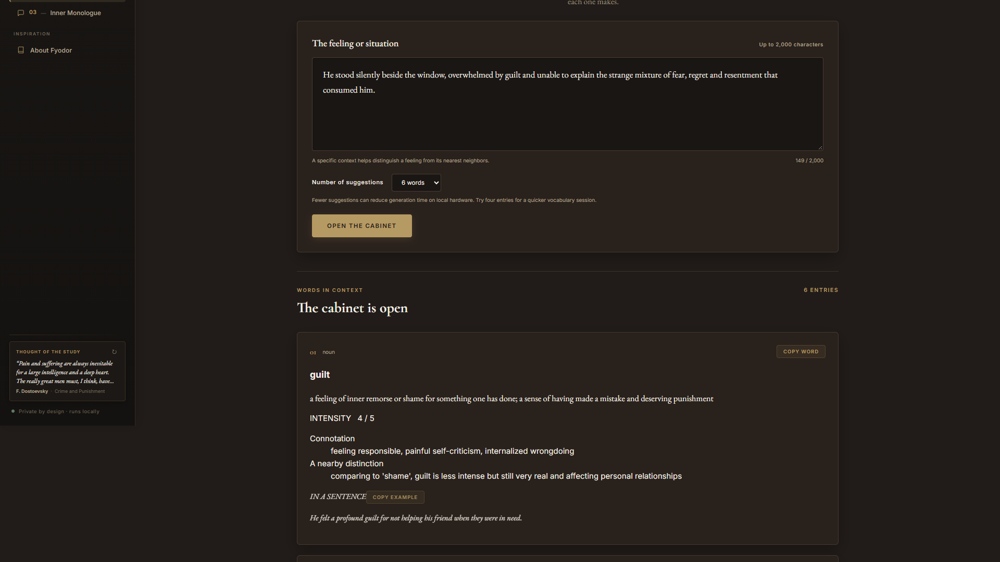
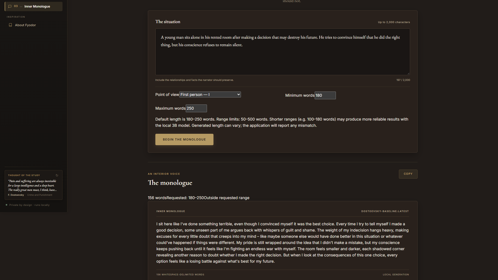
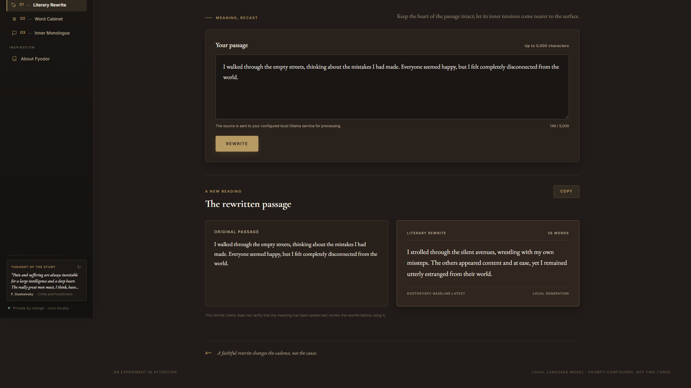
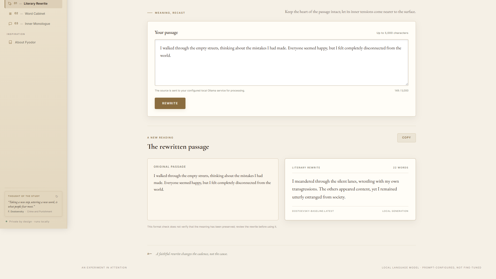
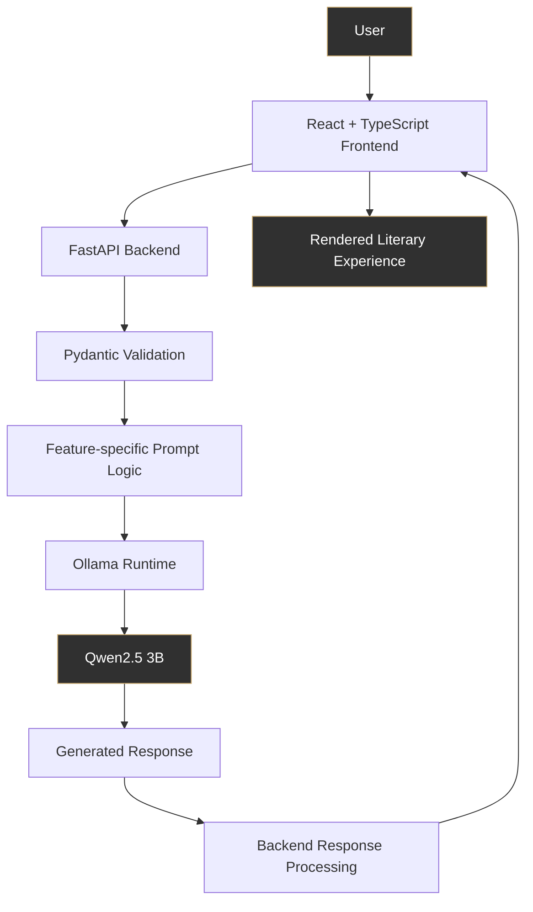
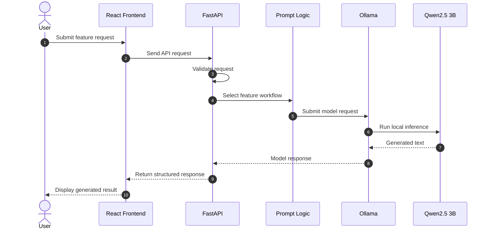
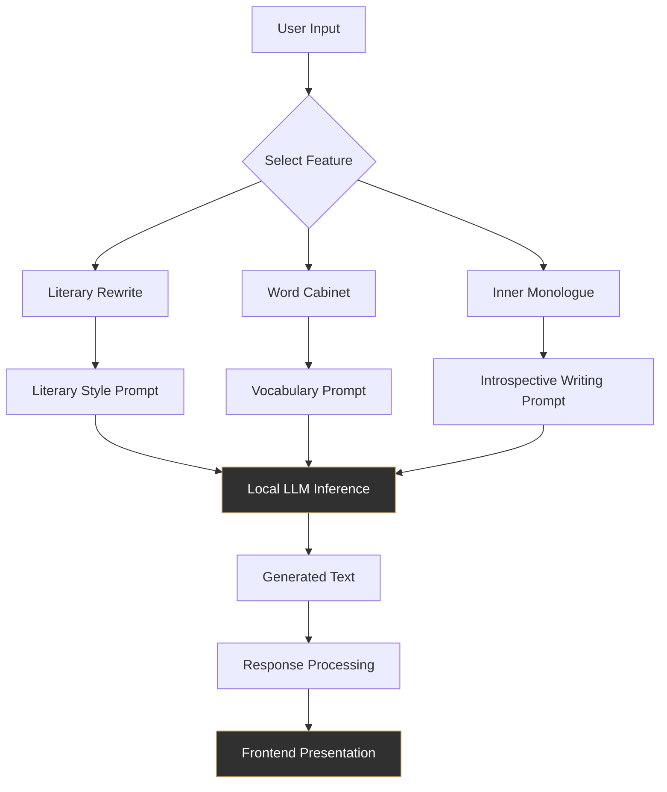
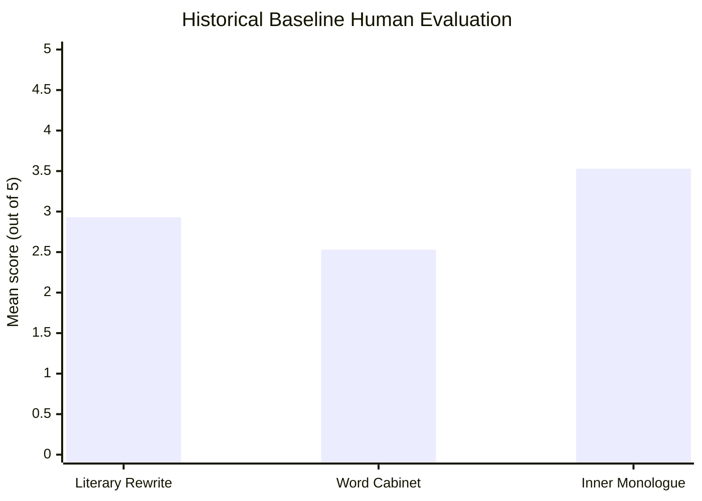
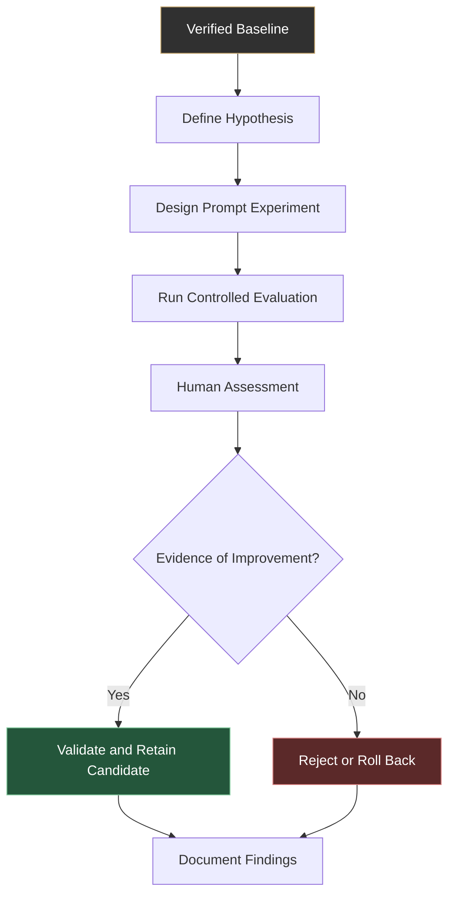

 <div align="center">

# ✒ DOSTOEVSKY AI

### THE UNDERGROUND STUDY

**Where Language Meets the Human Psyche.**

*A local-first literary writing and vocabulary assistant inspired by the psychological depth and philosophical complexity of Fyodor Dostoevsky.*

<br/>

[](https://www.python.org/)
[](https://fastapi.tiangolo.com/)
[](https://react.dev/)
[](https://www.typescriptlang.org/)
[](https://vite.dev/)
[](https://ollama.com/)

<br/>

**LOCAL-FIRST AI · LITERARY INTELLIGENCE · PROMPT ENGINEERING**

<br/>

[Explore Features](#-the-experience) · [Architecture](#-system-architecture) · [Evaluation](#-empirical-evaluation) · [Installation](#-getting-started)

<br/>

</div>

---

## ◈ The Idea

What if artificial intelligence could help you explore not just what you write, but how you express the complexities behind it?

**Dostoevsky AI** is an experimental literary intelligence application that brings together local language model inference, prompt engineering, and an elegant writing environment.

Inspired by the psychological and philosophical themes of Fyodor Dostoevsky, the application offers three specialized AI experiences:

- **Literary Rewrite** — Transform ordinary writing into more expressive literary prose.
- **Word Cabinet** — Explore vocabulary through contextual and literary explanations.
- **Inner Monologue** — Generate introspective writing shaped around internal conflict and human contradictions.

Rather than relying on a conventional cloud chatbot, Dostoevsky AI uses a locally hosted language model through Ollama.

The result is a privacy-conscious, locally executable AI writing environment.

---

## ◈ Inside The Underground Study

<div align="center">

### A closer look at the application


*The Underground Study — the home of literary exploration.*

</div>

### Three ways to explore language

<table>
<tr>
<td width="50%" valign="top">

### 01. Literary Rewrite


Transform ordinary text into expressive literary prose while attempting to preserve the original meaning and intent.

**Focus:** Style transformation, literary expression, semantic preservation.

</td>
<td width="50%" valign="top">

### 02. Word Cabinet



Explore vocabulary through contextual explanations and literary language.

**Focus:** Vocabulary exploration, contextual understanding, expressive language.

</td>
</tr>
<tr>
<td width="50%" valign="top">

### 03. Inner Monologue



Generate introspective monologues exploring contradictory emotions, internal conflict, and psychological depth.

**Focus:** Introspection, narrative voice, psychological expression.

</td>
<td width="50%" valign="top">

### 04. The Literary Identity


A dedicated interface celebrating the literary inspiration behind the project.

**Focus:** Product identity, literary inspiration, visual storytelling.

</td>
</tr>
</table>

### A study in light and shadow

<table>
<tr>
<td width="50%">



<p align="center"><b>Dark Mode</b></p>

</td>
<td width="50%">



<p align="center"><b>Light Mode</b></p>

</td>
</tr>
</table>

---

## ◈ The Experience

| Feature | Purpose | AI capability |
|---|---|---|
| Literary Rewrite | Transform writing style | Prompt-guided text generation |
| Word Cabinet | Explore vocabulary | Contextual language generation |
| Inner Monologue | Create introspective prose | Structured creative generation |

Each feature uses a specialized interaction and prompt workflow rather than treating every request as an identical chat conversation.

---

## ◈ System Architecture

Dostoevsky AI follows a local-first client-server architecture.

The frontend handles user interaction, the backend manages application logic and request validation, and Ollama serves the local language model.



### Architectural responsibilities

| Layer | Responsibility |
|---|---|
| Frontend | User interface, feature interactions and response presentation |
| Backend | API handling, application logic and orchestration |
| Validation | Structured request validation using Pydantic |
| Prompt layer | Feature-specific prompt construction |
| Inference runtime | Local model execution through Ollama |
| Language model | Qwen2.5 3B text generation |

### Request lifecycle



---

## ◈ How The AI Works

The application uses feature-specific prompt engineering around a locally hosted language model.

### Model configuration

| Component | Configuration |
|---|---|
| Base model | Qwen2.5 3B |
| Inference runtime | Ollama |
| Custom model | `dostoevsky-baseline:latest` |
| AI approach | Prompt engineering |
| Execution | Local inference |
| Fine-tuning | Not performed |

**An important distinction:** Dostoevsky AI does not claim to train or fine-tune its own foundation model. Its engineering focus is on designing specialized LLM workflows, prompt structures, validation, inference integration, and empirical evaluation.

### Feature-specific AI workflow



---

## ◈ Technology Stack

The project combines modern frontend engineering, Python backend development, and local language model inference.

<div align="center">

### Frontend

[](https://react.dev/)
[](https://www.typescriptlang.org/)
[](https://vite.dev/)

### Backend

[](https://python.org/)
[](https://fastapi.tiangolo.com/)
[](https://docs.pydantic.dev/)

### AI / ML

[](https://ollama.com/)
[](https://qwenlm.github.io/)

### Development and Quality

[](https://git-scm.com/)
[](https://github.com/)

</div>

---

## ◈ Empirical Evaluation

A central part of this project is evaluating generated outputs rather than assuming that a prompt change automatically produces better results.

The project uses human rubric-based evaluation and controlled prompt experiments to investigate output quality across its three features.

### Historical baseline results

<div align="center">

| Metric | Result |
|---|---:|
| Overall mean | **3.00 / 5** |
| Test cases | **15** |
| Criterion ratings | **45** |

</div>

### Feature-level results



| Feature | Baseline mean |
|---|---:|
| Literary Rewrite | 2.93 / 5 |
| Word Cabinet | 2.53 / 5 |
| Inner Monologue | 3.53 / 5 |

*These are historical baseline human-rubric results from 15 test cases and 45 criterion ratings. They are not universal quality scores or benchmark accuracy.*

### Experimentation philosophy



### A negative result is still a result

The Word Cabinet EXP-WC-02 experiment did not demonstrate improvement.

The human evaluation produced a score delta of **-0.20**, leading to a rollback to the verified baseline prompt.

Verified baseline prompt hash:

`be472f536fbb27ed460f03e744889c95af91db3a8f8ac8809992ac55dd447686`

This is an important part of the project's development philosophy:

- Hypotheses must be tested.
- Results must be evaluated.
- Negative findings must be preserved.
- Experimental changes must earn their place through evidence.
- The baseline should remain active when an experiment fails to demonstrate improvement.

The objective is not to make every experiment look successful. It is to make engineering decisions based on evidence.

---

## ◈ Privacy-First by Design

Dostoevsky AI is designed around local execution.

Its local-first approach aims to keep model inference on the user's own machine rather than depending on a third-party hosted LLM API.

Key design principles:

- Locally hosted model inference.
- Local application execution.
- No requirement for a third-party LLM API for the documented inference workflow.
- Clear separation between frontend, backend, and model runtime.

Privacy statements should be understood within the scope of the verified application implementation. Local execution does not by itself guarantee complete device security.

---

## ◈ Getting Started

### Prerequisites

Install the following:

- Python.
- Node.js and npm.
- Ollama.
- Git.

### 1. Clone the repository

```bash
git clone https://github.com/obj8899/dostoevsky-ai.git
cd dostoevsky-ai
```

### 2. Set up the local language model

Install and start Ollama, then retrieve the Qwen2.5 3B base model:

```bash
ollama pull qwen2.5:3b
```

The application uses the custom Ollama model `dostoevsky-baseline:latest`. Follow the repository's model configuration and Modelfile instructions to create it if it is not already available.

### 3. Configure the backend

Navigate to the backend directory:

```bash
cd backend
```

Install the Python dependencies using the dependency file provided in the repository.

Configure any required environment variables using the supplied example configuration.

Start the backend using the launch instructions documented in the backend configuration.

### 4. Start the frontend

Open another terminal in the repository root:

```bash
cd frontend
npm install
```

Start the frontend using the development script defined in `frontend/package.json`.

> **Note:** Verify the backend dependency filename, environment variables, startup command, and frontend script against the current repository before using these instructions. Do not assume default ports or configuration values.

---

## ◈ Project Structure

```text
dostoevsky-ai/
│
├── backend/
│   └── FastAPI application and backend logic
│
├── frontend/
│   ├── public/
│   └── src/
│       ├── components/
│       ├── pages/
│       ├── data/
│       ├── styles/
│       └── utils/
│
├── scripts/
│   └── Corpus processing and validation utilities
│
├── evaluation/
│   ├── Experiments
│   ├── Evaluation harnesses
│   └── Aggregate evaluation reports
│
├── docs/
│   └── screenshots/
│
├── Modelfile
├── README.md
└── .env.example
```

*Directory descriptions are representative; consult the repository for the complete current structure.*

---

## ◈ Limitations

Dostoevsky AI is an experimental local-first LLM application, not a claim of human-level literary understanding.

Known considerations include:

- The 3B parameter model has limitations in complex generation tasks.
- Literary rewrites may introduce semantic drift.
- Vocabulary explanations require independent correctness checks.
- Generated outputs may not always comply with requested word counts.
- Output quality can vary between prompts and inputs.
- Local inference performance depends on available hardware.
- The model has not been fine-tuned for this application.
- The historical human evaluation uses a relatively small sample.

These limitations are part of the engineering problem being explored.

---

## ◈ Roadmap

The project can evolve through evidence-driven development.

- [x] Local language model integration.
- [x] Three specialized AI writing features.
- [x] FastAPI backend.
- [x] React and TypeScript frontend.
- [x] Human rubric-based evaluation.
- [x] Controlled prompt experiments.
- [x] Experimental rollback based on evaluation.
- [ ] Expanded evaluation coverage.
- [ ] Further prompt optimization.
- [ ] Improved generation consistency.
- [ ] Additional evaluation and usability improvements.

---

## ◈ The Philosophy Behind The Project

> "The mystery of human existence lies not in just staying alive, but in finding something to live for."

Dostoevsky's literary world is filled with contradiction, introspection, moral uncertainty, and the complexity of human consciousness.

This project explores how modern language models can be used as tools for literary expression and creative exploration.

It is not about replacing the writer.

It is about giving language another dimension.

---

<div align="center">

## DOSTOEVSKY AI

### THE UNDERGROUND STUDY

*Built at the intersection of literature, language, and artificial intelligence.*

<br/>

**Designed for exploration. Engineered for experimentation. Grounded in evidence.**

<br/>

[GitHub Repository](https://github.com/obj8899/dostoevsky-ai)

<br/>

<sub>Inspired by the literary legacy of Fyodor Dostoevsky.</sub>

</div>
