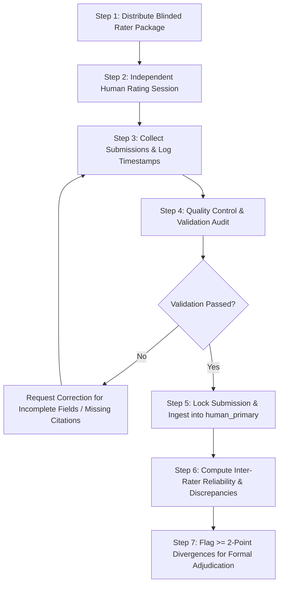

# Dostoevsky AI — Blinded Human Evaluation Coordinator Guide

**Document Version:** 1.0.0  
**Status:** HUMAN-PRIMARY — UNRATED (Operational Coordinator Guide)  
**Target Run ID:** `run_20261025T180347Z_63cb94586e9f4132adf9952aae03efbb`  
**Total Evaluation Items:** 30 (10 Literary Rewrite, 10 Word Cabinet, 10 Inner Monologue)  
**Total Ratings per Rater:** 90 criterion-level ratings  

---

## 1. Objectives & Role of the Evaluation Coordinator

The Evaluation Coordinator oversees the collection, validation, and safeguarding of independent human ratings for the Dostoevsky AI Phase 4A benchmark.

The Coordinator is strictly responsible for:
1. **Blinding Integrity:** Ensuring human raters receive only blinded materials without access to:
   - Model identities, provider names, base architectures, or serving configurations
   - The Randomization Mapping Key (`blinded_human_evaluation_key_...json`)
   - Automated execution diagnostics, latencies, or token statistics
   - Existing `ai_assisted_preliminary` scores, evidence notes, boundary notes, or summary statistics
2. **Standardization:** Ensuring all raters evaluate the same 30 canonical outputs using the finalized 1–5 scoring scale and criterion definitions.
3. **Data Quality & Completeness:** Verifying that submitted scorecards contain all 90 integer scores, concrete textual evidence notes for every criterion, and explicit boundary notes for ambiguous decisions.
4. **Data Isolation & Provenance:** Ingesting ratings into the `human_primary` tier of the dedicated scoring container without modifying existing preliminary scores or overwriting other raters' submissions.

---

## 2. Human Evaluation Workflow & Step-by-Step Procedure



### Step 1: Package Distribution
Provide the human rater with only:
- `HUMAN_RATER_INSTRUCTIONS.md`
- `HUMAN_PRIMARY_UNRATED_WORKSHEET.md` (or `HUMAN_PRIMARY_UNRATED_RESPONSE_TEMPLATE.json`)
- `SUBMISSION_CHECKLIST.md`

*Prohibition:* Never share `blinded_human_evaluation_scores_run_20261025T180347Z.json` or `blinded_human_evaluation_key_run_20261025T180347Z.json` with raters.

### Step 2: Rating Execution
Raters independently evaluate the 30 items in feature batches:
1. Literary Rewrite (`LR_ITEM_01` to `LR_ITEM_10`)
2. Word Cabinet (`WC_ITEM_01` to `WC_ITEM_10`)
3. Inner Monologue (`IM_ITEM_01` to `IM_ITEM_10`)

### Step 3: Receipt & Timestamp Logging
Upon receiving a completed rater package:
1. Record receipt timestamp in UTC.
2. Confirm the rater's designated anonymous identifier (e.g. `human_rater_01`).
3. Compute and record the SHA-256 hash of the received submission file.

### Step 4: Quality Control Audit
Before accepting any submission, the Coordinator must verify:
- [ ] Exactly 30 items rated.
- [ ] Exactly 90 integer scores present in range $[1, 5]$.
- [ ] Zero null, blank, or placeholder scores.
- [ ] Every score accompanied by a non-empty evidence note citing specific text from the output.
- [ ] Every score of 1 or 2 explicitly cites the serious defect or triggered failure condition.
- [ ] Every score of 5 explicitly explains why the output warrants the highest rating rather than 4.
- [ ] Boundary notes are recorded for borderline cases (especially near 2/3, 3/4, or 4/5).
- [ ] Strict decoupling was maintained: word count diagnostic variances were not penalized under literary criteria.

### Step 5: Data Ingestion
Once validated, the submission is appended as a distinct object to `evaluations.human_primary` in the scoring container:
```json
{
  "rater_id": "human_rater_01",
  "scores": { "LR_CRIT_1": 4, "LR_CRIT_2": 3, "LR_CRIT_3": 4 },
  "evidence_notes": { ... },
  "boundary_notes": { ... },
  "rated_at_utc": "2026-10-29T14:00:00Z"
}
```

### Step 6: Discrepancy & Adjudication Trigger Analysis
When multiple raters have submitted:
1. Identify exact agreement count and percentage across all 90 criteria.
2. For 1-point discrepancies (e.g. Rater A = 4, Rater B = 3):
   - Calculate arithmetic mean for reporting.
   - Do not automatically treat as resolved; retain individual ratings.
3. For $\ge 2$-point discrepancies (e.g. Rater A = 4, Rater B = 2):
   - Mandatory trigger for formal adjudication.
   - Prepare an adjudication dossier containing both raters' evidence notes and the case-specific failure conditions.

---

## 3. Contamination & Independence Safeguards

1. **Prior Exposure Disclosure:** Any evaluator who has reviewed the preliminary AI-assisted scorecard must disclose that exposure. Their ratings cannot be classified as fully blinded.
2. **No AI-Assisted Raters in Human Tier:** The `human_primary` tier is strictly reserved for human evaluators. No model or agent may generate or fill entries in this tier.
3. **Audit Trail Immutability:** Original submitted files from raters must be preserved in an immutable archive with date/time stamps and cryptographic hashes.

---

## 4. Operational Gaps & Decisions Requiring Project Lead Approval

The following operational decisions require explicit sign-off from the project lead before rating commences:
1. **Rater Cohort Size:** Whether Phase 4A requires $N=1$ primary human rater, $N=2$ dual-independent raters, or a panel of $N \ge 3$.
2. **Disagreement Adjudicator Role:** Designate who serves as the formal adjudicator for $\ge 2$-point discrepancies.
3. **Submission Format:** Confirm whether raters will submit Markdown worksheets or JSON response templates.
