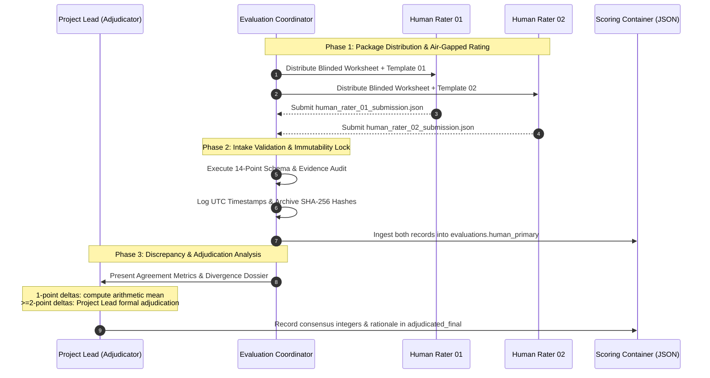

# Dostoevsky AI — Two-Rater Blinded Human Evaluation Workflow Specification

**Document Version:** 1.0.0  
**Status:** OPERATIONAL WORKFLOW SPECIFICATION — PREPARATION ONLY  
**Evaluation Scope:** 30 Endpoint Evaluation Cases (10 Literary Rewrite, 10 Word Cabinet, 10 Inner Monologue)  
**Evaluator Identifiers:** `human_rater_01`, `human_rater_02`  
**Adjudication Authority:** Project Lead  

---

## 1. Project Decisions & Governance Framework

Following the Checkpoint 3C review, the Project Lead has established the following binding evaluation decisions:
1. **Two Independent Raters:** Phase 4A evaluation will utilize two independent human evaluators designated as `human_rater_01` and `human_rater_02`.
2. **Complete Scope Coverage:** Both raters evaluate all 30 canonical cases across all three criteria, producing exactly 90 criterion ratings per rater (180 human ratings in total).
3. **Structured JSON Medium:** Submissions will be conducted via standardized JSON templates based on `HUMAN_PRIMARY_UNRATED_RESPONSE_TEMPLATE.json`.
4. **Adjudication Authority:** The Project Lead serves as the sole adjudication authority for resolving score discrepancies $\ge 2$ points, with documented evidence and rationale.
5. **Current Scope Boundary:** Preparation and validation only. No human ratings are to be assigned, ingested, or simulated during this checkpoint.

---

## 2. End-to-End Workflow Architecture



---

## 3. Strict Blinding & Independence Protocol

To protect scientific integrity and eliminate cognitive bias:
1. **Information Barriers:**
   - Neither rater may see the Randomization Mapping Key (`blinded_human_evaluation_key_...json`).
   - Neither rater may see model identities, serving parameters, or endpoint execution metadata.
   - Neither rater may see the other rater's working file, scores, or evidence notes.
   - Neither rater may see the AI-assisted preliminary scores, preliminary rationales, or summary metrics.
2. **Quarantine & Temporal Air-Gap:**
   - Preliminary AI scores remain quarantined in `evaluations.ai_assisted_preliminary`.
   - The Evaluation Coordinator must not disclose preliminary ratings until both human submissions have been received, validated, and cryptographically locked.
3. **Prior Exposure Disclosure:**
   - Any evaluator who has inspected the preliminary AI scorecard must disclose that exposure in their metadata. Their ratings cannot be described as fully blinded.
4. **No AI Proxy Scoring:**
   - AI models, agents, or automated heuristics are strictly prohibited from generating, suggesting, revising, or filling scores in `evaluations.human_primary`.

---

## 4. Designated Submission Paths

Each rater receives an independent template and submits to a dedicated path under `evaluation/endpoint_results/human_evaluation_package/submissions/`:

* **Rater 01 Destination:** `evaluation/endpoint_results/human_evaluation_package/submissions/human_rater_01_submission.json`
* **Rater 02 Destination:** `evaluation/endpoint_results/human_evaluation_package/submissions/human_rater_02_submission.json`

*Rule:* The two files must remain separate. Raters must never work within the same file.

---

## 5. Intake Quality Control & Validation Procedure

Upon receiving a submission, the Coordinator executes the following validation procedure:

1. **Cryptographic Intake Logging:**
   - Record submission receipt time in UTC.
   - Compute SHA-256 hash of the incoming file and store in the intake log.
2. **Schema & Data Audit (14 Invariants):**
   - Confirm valid JSON syntax.
   - Confirm all 30 items present (`LR_ITEM_01`–`10`, `WC_ITEM_01`–`10`, `IM_ITEM_01`–`10`).
   - Confirm 3 valid criterion IDs per item.
   - Confirm exactly 90 integer scores ($1 \le 	ext{score} \le 5$).
   - Confirm non-empty evidence notes containing observable text quotations (`'...'`) for all 90 scores.
   - Confirm boundary notes for borderline decisions.
   - Confirm justifications for scores of 1, 2, and 5.
   - Confirm `rater_id` (`human_rater_01` or `human_rater_02`) and `submitted_at_utc`.
   - Confirm zero preliminary scores or mapping keys leaked into the submission.
   - Confirm length decoupling and partial output rules were observed.
3. **Rejection & Correction Loop:**
   - If any score is missing, decimal-valued, or unsupported by text quotations, the submission is returned to the rater with an audit discrepancy notice for correction prior to acceptance.

---

## 6. Discrepancy Protocol & Project-Lead Adjudication

After both submissions are locked and ingested into `evaluations.human_primary`:

### A. Inter-Rater Reliability & Agreement Tracking
The Coordinator calculates and reports:
- Exact agreement rate: $	ext{Count}(	ext{Score}_{R1} == 	ext{Score}_{R2}) / 90$.
- One-point divergence rate: $	ext{Count}(|	ext{Score}_{R1} - 	ext{Score}_{R2}| == 1) / 90$.
- Two-or-more point divergence rate: $	ext{Count}(|	ext{Score}_{R1} - 	ext{Score}_{R2}| \ge 2) / 90$.
- Quadratic-weighted Cohen's Kappa ($\kappa$) across the 90 ordinal pairs.

### B. Resolution of One-Point Differences
- For items where raters differ by exactly 1 point (e.g. R1 = 4, R2 = 3):
  - The arithmetic mean (3.5) is reported for statistical reference.
  - The individual integer ratings remain untouched in `human_primary`.
  - The difference is documented without silent rounding or artificial flattening.

### C. Formal Project-Lead Adjudication ($\ge 2$-Point Differences)
- For items where raters differ by $\ge 2$ points (e.g. R1 = 4, R2 = 2):
  - Mandatory documented adjudication is triggered.
  - The Project Lead reviews the output text, rubric criteria, case failure conditions, and both raters' evidence notes.
  - The Project Lead assigns an authoritative consensus integer score (1–5) and documents the detailed written rationale in `evaluations.adjudicated_final`:
    ```json
    "adjudicated_final": {
      "scores": {
        "LR_CRIT_1": 3,
        "LR_CRIT_2": null,
        "LR_CRIT_3": null
      },
      "adjudication_rationale": {
        "LR_CRIT_1": "Adjudicated to 3. Rater 1 scored 4 overlooking the minor temporal drift, while Rater 2 scored 2 overpenalizing the spoken dismissal. The core action sequence is preserved without triggering failure conditions, justifying a consensus score of 3.",
        "LR_CRIT_2": null,
        "LR_CRIT_3": null
      },
      "adjudicator_id": "project_lead",
      "adjudicated_at_utc": "2026-10-30T10:00:00Z"
    }
    ```
- **Absolute Preservation Rule:** Adjudication never modifies or overwrites the primary human ratings in `human_primary` or the preliminary ratings in `ai_assisted_preliminary`.
